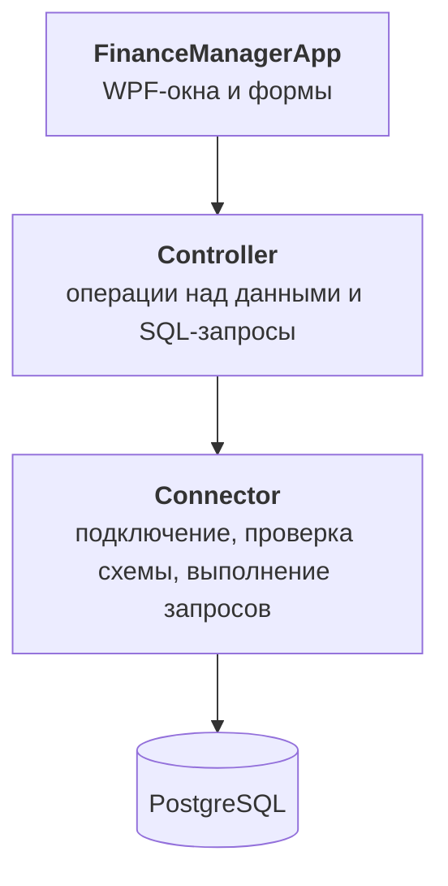
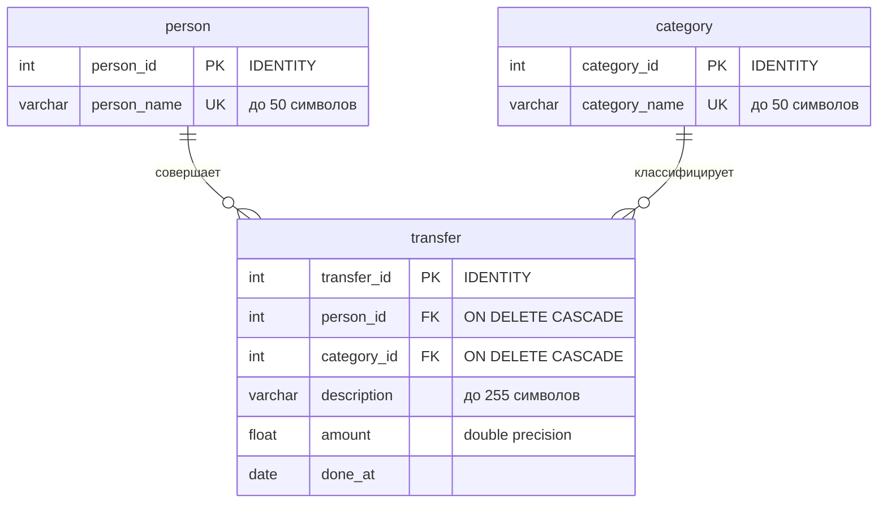

# Finance Manager


Десктопное приложение для учёта личных и семейных финансов. Ведёт доходы и расходы нескольких пользователей, переводы между ними и строит отчёты по пользователям, категориям и периодам. Данные хранятся в PostgreSQL.

## Содержание

- [Возможности](#возможности)
- [Технологии](#технологии)
- [Архитектура](#архитектура)
- [Ключевые технические решения](#ключевые-технические-решения)
- [Схема базы данных](#схема-базы-данных)
- [Структура проекта](#структура-проекта)
- [Запуск](#запуск)
- [Лицензия](#лицензия)

## Возможности

**Пользователи**
- Добавление и удаление пользователей.
- Баланс каждого пользователя считается как сумма всех его операций.

**Операции**
- Доход или расход: положительная или отрицательная сумма, дата и описание.
- Операцию можно отнести к пользовательской категории («Продукты», «Транспорт» и т. д.) или записать как единовременную транзакцию с произвольным описанием.
- Перевод между пользователями: у отправителя создаётся списание, у получателя зачисление. Если вторая запись не сохранилась, первая удаляется.

**Категории**
- Две системные категории: «Перевод между пользователями» и «Единовременная транзакция».
- Свои категории можно добавлять и удалять в отдельном окне.

**Отчёты**
- 8 видов отчётов: сводка сумм по категориям и выборки операций с любым сочетанием фильтров «пользователь», «категория» и «период».
- Экспорт любого отчёта в CSV.

**Интерфейс и надёжность**
- Интерфейс в стиле Fluent Design (WPF-UI): тёмная тема и эффект Mica.
- Поля форм проверяются при вводе: неверное поле подсвечивается и показывает подсказку.
- При запуске приложение проверяет подключение к БД и структуру таблиц. Если таблиц нет, оно предлагает создать их.

## Технологии

| Область | Технология |
|---|---|
| Язык и платформа | C# 10, .NET 6 (`net6.0-windows`) |
| UI | WPF, [WPF-UI](https://github.com/lepoco/wpfui) 2.0.3 |
| База данных | PostgreSQL |
| Доступ к данным | [Npgsql](https://www.npgsql.org/) 8.0.1 (ADO.NET, без ORM) |
| Конфигурация | Newtonsoft.Json 13.0.3 |

## Архитектура

Решение `FinanceManager.sln` состоит из трёх проектов. Каждый слой обращается только к слою под ним:



- **FinanceManagerApp** — WPF-приложение: главное окно с вкладками «Пользователи», «Переводы» и «Отчёты», формы ввода, валидация, экспорт в CSV. Npgsql в этом проекте не используется.
- **Controller** — операции предметной области: выборки, отчёты, добавление и удаление пользователей, категорий и операций. Результаты возвращает в виде `DataTable`.
- **Connector** — работа с PostgreSQL: строка подключения, проверка схемы БД, создание таблиц, выполнение запросов (`ExecuteAction`, `ExecuteScalar`, `ExecuteTable`).

## Ключевые технические решения

- **Параметризованные запросы.** Пользовательский ввод попадает в SQL только через `NpgsqlParameter`, поэтому SQL-инъекции исключены.
- **Проверка схемы БД при запуске.** `Connector` через `information_schema` проверяет, что нужные таблицы есть и у каждого столбца правильные тип, `IDENTITY` и `NULL`. Результат хранится в `enum DatabaseState` (`Correct` / `Incorrect` / `Missing`). По нему приложение показывает ошибку подключения или предлагает пересоздать схему.
- **Откат при переводе между пользователями.** Перевод состоит из двух операций. Если вторая завершилась ошибкой, первая удаляется, и балансы не расходятся.
- **Фильтры отчётов на битовых флагах.** Тип отчёта задаётся `[Flags] enum ReportType { Person, Date, Category }`. Форма параметров показывает только нужные поля, а нужный запрос выбирается по комбинации флагов.
- **Целостность данных на уровне БД.** Внешние ключи с `ON DELETE CASCADE` и уникальные имена пользователей и категорий: при удалении пользователя или категории удаляются и связанные операции.

## Схема базы данных

Таблицы создаются автоматически при первом запуске (`Connector.CreateTables`).



## Структура проекта

```
FinanceManagerWpf/
├── FinanceManager.sln
├── connectionConfig.example.json     # пример настроек подключения к БД
├── Connector/
│   └── Connector.cs                  # подключение, проверка и создание схемы, выполнение запросов
├── Controller/
│   └── Controller.cs                 # выборки, отчёты, добавление и удаление данных
└── FinanceManagerApp/
    ├── App.xaml                      # тема WPF-UI и общие стили
    ├── MainWindow.xaml(.cs)          # главное окно: пользователи, переводы, отчёты, экспорт CSV
    ├── AddPerson.xaml(.cs)           # добавление пользователя
    ├── AddTransfer.xaml(.cs)         # добавление операции
    ├── AddPersonsTransfer.xaml(.cs)  # перевод между пользователями
    ├── AddCategory.xaml(.cs)         # управление категориями
    ├── ReportRequiredData.xaml(.cs)  # параметры отчёта
    ├── DatabaseSettings.cs           # модель файла connectionConfig.json
    └── Assets/                       # иконки
```

## Запуск

### Требования

- Windows 10/11
- [.NET SDK](https://dotnet.microsoft.com/download) 6.0 или новее для сборки и [.NET 6 Desktop Runtime](https://dotnet.microsoft.com/download/dotnet/6.0) для запуска
- PostgreSQL 10 или новее
- Visual Studio 2022 или JetBrains Rider (необязательно)

### Шаги

1. **Клонируйте репозиторий и соберите решение:**

   ```powershell
   git clone https://github.com/KonstantinUsikov/FinanceManagerWpf.git
   cd FinanceManagerWpf
   dotnet build
   ```

2. **Создайте пустую базу данных:**

   ```sql
   CREATE DATABASE finance_manager;
   ```

3. **Настройте подключение.** Скопируйте пример конфигурации в папку сборки и укажите свои параметры:

   ```powershell
   copy connectionConfig.example.json FinanceManagerApp\bin\Debug\net6.0-windows\connectionConfig.json
   ```

   ```json
   {
     "Host": "localhost",
     "Port": 5432,
     "Database": "finance_manager",
     "Username": "postgres",
     "Password": "your_password"
   }
   ```

   Приложение ищет `connectionConfig.json` в рабочей директории. При запуске из IDE или двойным кликом по `.exe` это папка сборки. Файл `connectionConfig.json` добавлен в `.gitignore`, так что пароль не попадёт в репозиторий.

4. **Запустите приложение** из Visual Studio или Rider (F5) либо из папки сборки:

   ```powershell
   cd FinanceManagerApp\bin\Debug\net6.0-windows
   .\FinanceManagerApp.exe
   ```

5. При первом запуске приложение сообщит, что база данных некорректна, и предложит пересоздать её. Нажмите **«Да»**, и таблицы будут созданы.
